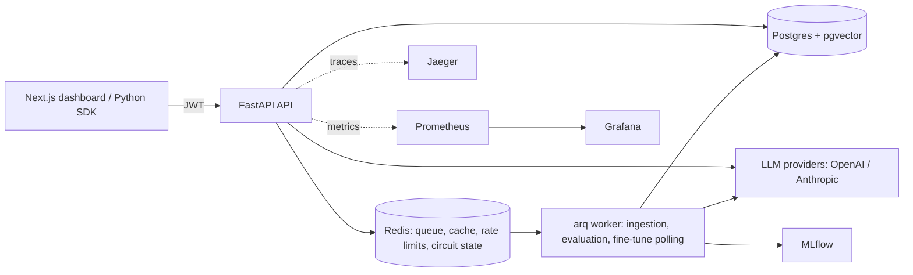

# NeuroFlow

NeuroFlow is a multi-modal retrieval-augmented generation (RAG) platform: it ingests PDFs, Word files, CSVs,
images and URLs, answers questions with cited, streamed responses, and scores every answer automatically.
High-quality answers feed a fine-tuning pipeline tracked in MLflow, so evaluation drives model improvement.

## Architecture



- **API (FastAPI):** authentication, validation, query orchestration, SSE streaming.
- **Worker (arq):** document ingestion, asynchronous evaluation, fine-tuning job polling, daily data retention.
- **Postgres + pgvector:** documents, chunks (HNSW vector index + full-text index), runs, evaluations, pipelines.
- **Redis:** job queue, embedding cache, rate limits, circuit breaker state, model router config, pub/sub.
- **MLflow:** fine-tuning experiments and model registry.
- **Observability:** OpenTelemetry traces in Jaeger, Prometheus metrics, two Grafana dashboards.

## Key features

- **Multi-modal ingestion:** PDF, DOCX, CSV, TXT, images (OCR/vision) and URLs
  - Fixed-size, semantic and hierarchical chunking, selected automatically by document type
  - Content-hash deduplication; MIME type and magic-byte validation; SSRF-safe URL fetching
- **Hybrid retrieval:** dense (pgvector HNSW) + sparse (Postgres full-text) + metadata search
  - Reciprocal rank fusion with tunable `rrf_k`, cross-encoder reranking, query expansion and type classification
  - Per-pipeline config (`dense_k`, `sparse_k`, `top_k_after_rerank`, `ef_search`), versioned and A/B comparable
- **Generation:** cited answers (`[Source N]`), token streaming over SSE, per-query-type prompts
- **Automated evaluation:** faithfulness, answer relevance, context precision, context recall, weighted overall score
  - Runs asynchronously after each answer; live feed in the dashboard; heuristic fallback when no LLM key is set
- **Fine-tuning loop:** training-pair extraction with quality, citation and PII filters, JSONL export,
  MLflow run per job, OpenAI job polling, automatic router registration
- **Resilience:** Redis-backed circuit breakers, token-bucket rate limiting, queue backpressure, per-task timeouts
- **Security:** JWT with scopes, HTML sanitization, two-layer prompt-injection defense, secret redaction before embedding
- **Observability:** spans for every pipeline stage, custom Prometheus metrics, alert rules, runbook
- **Tooling:** Python SDK, OpenAPI docs, GitHub Actions CI, unit/integration/load tests, retrieval benchmark

## Quality metrics

Measured with `evaluation/measure.py`. **Caveat:** this run used only 4 questions on a small corpus with fake
embeddings and a heuristic judge, so retrieval numbers are not meaningful. The sprint to hit all targets with a
real corpus was not completed (see limitations).

| Metric | Target | Measured |
|---|---|---|
| Faithfulness | > 0.78 | 0.84 |
| Answer relevance | > 0.75 | 0.77 |
| Context precision | > 0.72 | 0.43 (below target) |
| Context recall | n/a | 1.00 |
| Overall score | > 0.75 | 0.76 |
| P95 query latency | < 4 s | 6.7 s (below target) |
| Hit Rate@10 / MRR@10 | > 0.80 / > 0.60 | 1.0 / 1.0 on 4 questions, not reliable |

## Tech stack

| Component | Technology | Why |
|---|---|---|
| API | FastAPI, asyncpg | Async I/O, OpenAPI for free, SSE support |
| Database | Postgres 16 + pgvector | One store for relational data, vectors and full-text search |
| Queue / cache | Redis 7 + arq | Simple async job queue plus cache, rate limits and breaker state |
| Tracking | MLflow | Experiment tracking and model registry for fine-tuning |
| Tracing / metrics | OpenTelemetry, Jaeger, Prometheus, Grafana | Standard, vendor-neutral observability |
| Frontend | Next.js 16, Tailwind, Recharts, Monaco | Playground, pipeline manager, live evaluation feed |
| Auth | JWT (python-jose) | Stateless, scope-based authorization |
| Packaging | Docker, Compose, Nginx | Reproducible runs, non-root hardened images |
| CI | GitHub Actions, ruff, mypy, pytest, Locust | Lint, tests, security scans, load tests |

## Quick start

```bash
git clone https://github.com/abhinavshukla18/NeuroFlow-HiDevs.git
cd NeuroFlow-HiDevs
cp .env.example .env            # then fill in the secrets (see Configuration)
docker compose -f infra/docker-compose.yml --env-file .env up -d --build
curl http://localhost:8000/health
cd frontend && npm install && npm run dev      # dashboard at http://localhost:3000/login
```

Generate each secret with `python -c "import secrets; print(secrets.token_urlsafe(32))"`.
API docs: http://localhost:8000/docs · Jaeger: :16686 · Grafana: :3001 · MLflow: :5000 · Prometheus: :9090.

## API reference

Scopes: **none** (public), **any** (valid token), **query**, **ingest**, **admin**.

| Method | Path | Auth | Description |
|---|---|---|---|
| POST | /auth/token | none | Exchange client credentials for a JWT |
| POST | /ingest | ingest | Upload a file or URL for ingestion |
| GET | /documents, /documents/{id} | any | List documents / poll status |
| GET | /documents/{id}/chunks, /chunks/{id}, /chunks/{id}/similar | query | Inspect chunks, find similar chunks |
| POST | /query | query | Run a RAG query (blocking or streaming) |
| GET | /query/{run_id}/stream | query | Stream the answer over SSE |
| PATCH | /runs/{run_id}/rating | query | Rate an answer 1 to 5 |
| GET | /evaluations, /evaluations/{run_id}, /evaluations/stream | query | Evaluation results and live feed |
| POST / GET | /pipelines | admin / any | Create / list pipelines |
| GET | /pipelines/{id} | any | Get a pipeline |
| PATCH / DELETE | /pipelines/{id} | admin | Update (new version) / archive |
| POST | /pipelines/compare | query | A/B compare two pipelines |
| GET | /pipelines/{id}/runs, /pipelines/{id}/analytics | query | Run history, latency and cost analytics |
| POST / GET | /finetune/jobs, /finetune/jobs/{id} | admin | Start / inspect fine-tuning jobs |
| GET | /finetune/training-data/preview | admin | Preview extractable training pairs |
| POST | /admin/circuit-breaker/reset | admin | Close a circuit breaker |
| GET | /health, /metrics | none | Health status, Prometheus metrics |

## SDK usage

```python
import asyncio
from neuroflow import NeuroFlowClient

async def main():
    async with NeuroFlowClient("http://localhost:8000", "admin-client:YOUR_SECRET") as nf:
        doc = await nf.ingest_file("paper.pdf")               # waits until ingestion completes
        print(doc.filename, doc.chunk_count)
        pipeline = (await nf.list_pipelines())[0]["id"]
        async for token in nf.query("What is the main idea?", pipeline, stream=True):
            print(token, end="", flush=True)                  # tokens arrive progressively
        print(await nf.get_evaluation(nf.last_run_id))        # quality scores

asyncio.run(main())
```

Install with `pip install ./sdk`.

## Configuration

See [`.env.example`](.env.example). **Required:** `POSTGRES_PASSWORD`, `REDIS_PASSWORD`, `JWT_SECRET`,
`ADMIN_CLIENT_SECRET`, `QUERY_CLIENT_SECRET`. **Optional:** `OPENAI_API_KEY` / `ANTHROPIC_API_KEY` (without a key a
fake provider and fake embeddings are used), `OTEL_EXPORTER_OTLP_ENDPOINT`, `CORS_ORIGINS`, `DISABLE_RATE_LIMIT`.

## Known limitations

- **Not deployed.** `docs/deployment.md` has the Railway steps and rollback procedure, but the live deployment and
  its verification table were not completed, so there is no live URL.
- **Production compose not verified end to end.** The hardened images and `docker-compose.prod.yml` were written
  but never fully run, so the non-root, read-only filesystem, image-size and Nginx load-balancing checks are untested.
- **Quality targets not demonstrated.** The sprint scripts, an embedding cache, tunable `ef_search`/`rrf_k` and a
  prompt A/B script exist, but the final numbers on a real corpus were not collected. Context precision (0.43) and
  P95 latency (6.7 s) were below target in the only baseline run.
- **Linting is lenient** (`ruff` rules E/F/I, mypy non-strict).
- **Not implemented:** container sandboxing of document extraction, chaos tests, preview environments,
  semantic-release automation, the Retrieval Inspector view.
- **Streaming auth** accepts the token as a query parameter for browser `EventSource`; short-lived stream tickets would be safer.

**Next:** a real staging deployment, a proper evaluation corpus with real embeddings, then rerun the quality sprint.