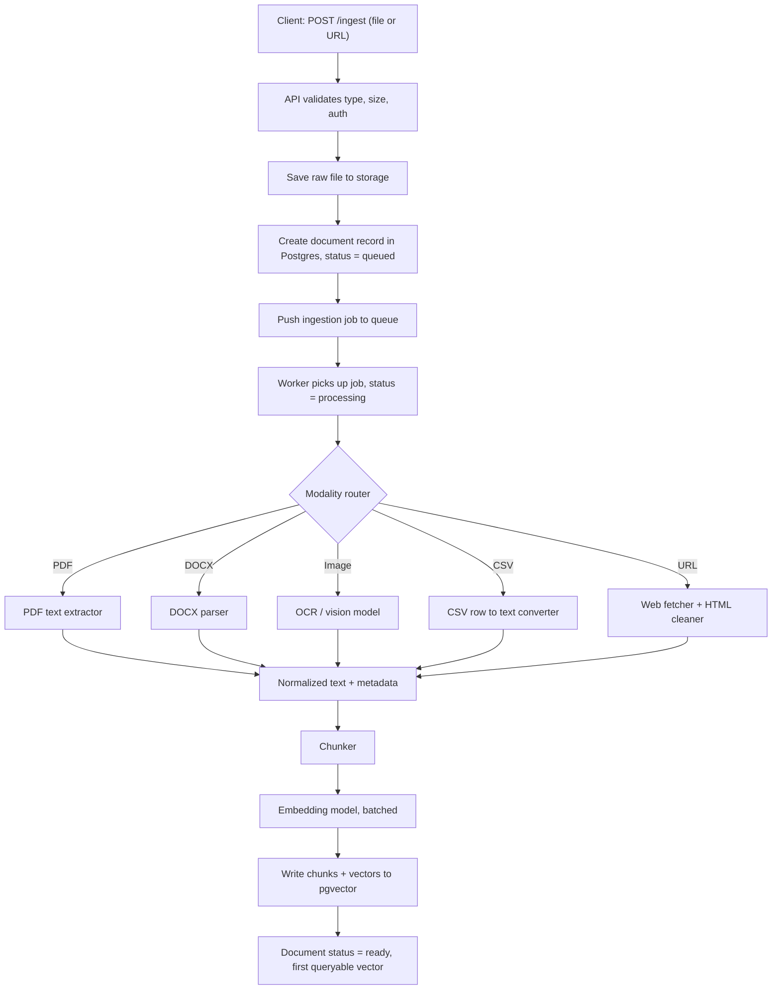
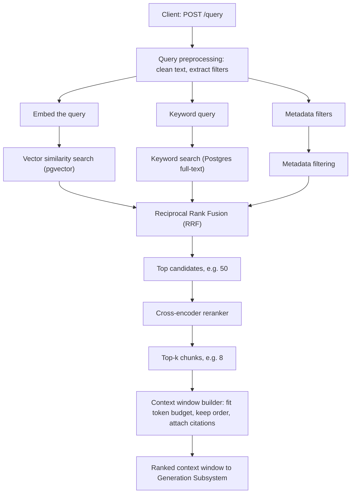
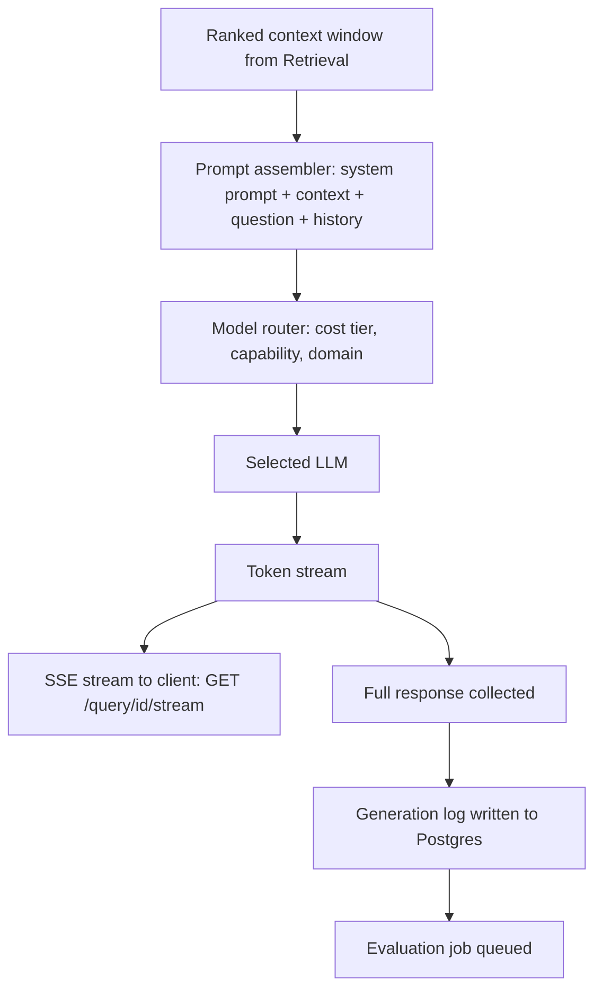
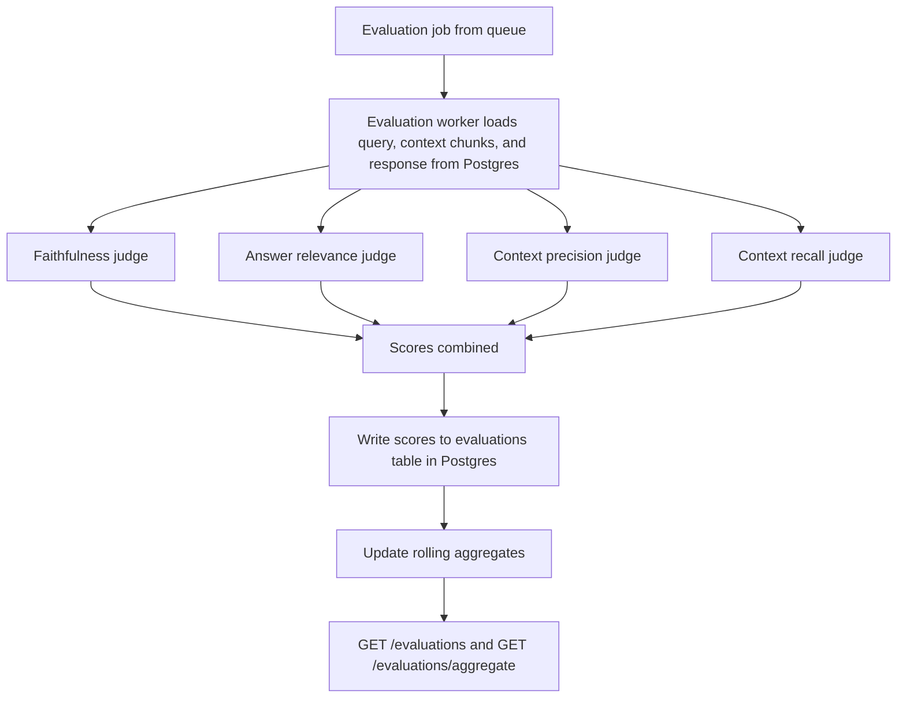
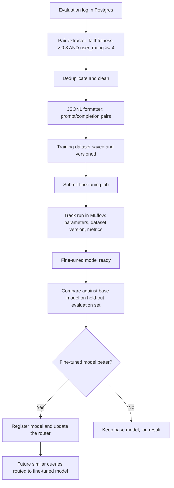

# NeuroFlow System Architecture

## 1. Overview

NeuroFlow is a Retrieval-Augmented Generation (RAG) platform. Users upload documents, ask questions, and receive streamed answers grounded in their own data. Every answer is automatically scored for quality, and the best answers are later used to fine-tune the models.

The system is made of five subsystems:

1. Ingestion: turns raw files into searchable vectors
2. Retrieval: finds the most relevant chunks for a query
3. Generation: builds the prompt, picks an LLM, and streams the answer
4. Evaluation: scores every answer asynchronously
5. Fine-Tuning: learns from the best answers

## 2. Ingestion Subsystem

**Purpose:** Accept raw inputs (PDF, DOCX, images, CSV, web URLs), extract content according to file type, split it into chunks, embed the chunks, and store them in the vector store so they can be searched.

### 2.1 Data Flow: File Upload to First Queryable Vector


### 2.2 Stage Descriptions

| Stage | What happens | Why |
|---|---|---|
| Validate | The API checks the auth token, file type, and file size limit. | Bad input is rejected before it costs any compute. |
| Save raw file | The original file goes to object or disk storage. | The raw file is kept so a document can be re-processed later with a new chunker or embedding model. |
| Document record | A row is created in Postgres with status `queued`. | The client gets a `document_id` back immediately and can poll for status. |
| Job queue | An ingestion job is pushed to a queue (Redis). | Extraction and embedding are slow, so they run in background workers and never block the API. |
| Modality router | The worker picks an extractor based on the file type. | Each format needs different handling. |
| Extractors | PDF and DOCX give text. Images go through OCR or a vision model. CSV rows become text. URLs are fetched and cleaned of HTML noise. | Every modality is turned into the same form: normalized text plus metadata. |
| Chunker | The text is split into chunks (strategy decided in ADR 002). | Chunks must be small enough to embed well and large enough to keep meaning. |
| Embedder | Chunks are sent to the embedding model in batches. | Batching reduces cost and API calls. |
| Vector write | Chunks, vectors, and metadata are written to pgvector (ADR 001). | This is the

### 2.4 Metadata Stored With Each Chunk

Every chunk is stored with metadata so that retrieval can filter and cite sources later.

| Field | Example | Used for |
|---|---|---|
| `chunk_id` | UUID | Unique ID of the chunk |
| `document_id` | UUID | Links the chunk back to its source document |
| `source_type` | `pdf`, `docx`, `image`, `csv`, `url` | Metadata filtering by modality |
| `source_name` | `report.pdf` or the URL | Showing citations to the user |
| `page_or_row` | `12` | Pointing to the exact location in the source |
| `chunk_index` | `5` | Keeping chunks in their original order |
| `created_at` | timestamp | Filtering by date |
| `embedding_model` | model name and version | Knowing which vectors need re-embedding if the model changes |

**Output of this subsystem:** a document with status `ready`, and its chunks stored as vectors in pgvector, searchable by the Retrieval Subsystem.

## 3. Retrieval Subsystem

**Purpose:** Given a user query, find the most relevant chunks using several search methods at once, combine the results, rerank them, and return a ranked context window for the Generation Subsystem.

### 3.1 Full Retrieval Pipeline



### 3.2 Stage Descriptions

| Stage | What happens | Why |
|---|---|---|
| Query preprocessing | The query text is cleaned, and any filters it implies (file type, date range) are extracted. | Clean input gives better search, and filters narrow the search space. |
| Query embedding | The query is converted to a vector with the same embedding model used at ingestion. | Query and chunk vectors must come from the same model to be comparable. |
| Vector search | pgvector returns the chunks whose vectors are closest to the query vector. | Finds chunks that match in meaning, even with different wording. |
| Keyword search | Postgres full-text search returns chunks that contain the query terms. | Finds exact matches such as names, IDs, and rare terms that embeddings can miss. |
| Metadata filtering | Chunks are restricted by fields such as `source_type` or `created_at`. | Lets users scope a query, for example "only PDFs from this year". |
| Reciprocal Rank Fusion | The ranked lists are merged into one list (see 3.3). | Combines different search methods without needing to compare their raw scores. |
| Cross-encoder reranker | A model reads the query and each candidate chunk together and scores how relevant the pair is. | More accurate than vector search, but too slow to run on every chunk, so it only runs on the top candidates. |
| Context window builder | The top chunks are trimmed to fit the LLM's token budget, kept in a sensible order, and tagged with citation info. | The output must fit the model's context limit and let the answer cite its sources. |

The three searches run in parallel, so total latency is set by the slowest one, not the sum of all three.

### 3.3 Reciprocal Rank Fusion (RRF)

Vector scores and keyword scores are on different scales, so they can't be added directly. RRF avoids this by using only each chunk's **rank** in each list:

```
RRF_score(chunk) = sum over all lists of 1 / (k + rank_in_that_list)
```

`k` is a constant, usually 60, that stops the top ranks from dominating.

**Example:**

- Chunk A is rank 1 in vector search and rank 3 in keyword search: 1/61 + 1/63 ≈ 0.0323
- Chunk B is rank 2 in vector search and missing from keyword search: 1/62 ≈ 0.0161

Chunk A wins because both methods agree it is relevant. Chunks are then sorted by RRF score and the top candidates go to the reranker.

### 3.4 Inputs and Outputs

**Input:** a query string, plus optional filters (source type, date range, document IDs) and a pipeline configuration (how many candidates and top-k chunks to use).

**Output:** a ranked context window, which is a list of chunks, each containing:

| Field | Purpose |
|---|---|
| `chunk_id` and `text` | The content to put in the prompt |
| `source_name` and `page_or_row` | Citation information |
| `rerank_score` | How relevant the reranker judged the chunk |
| `rank` | Position in the final ordering |

The retrieved chunk IDs are also saved with the query record, so the Evaluation Subsystem can later measure context precision and context recall.

### 3.5 Edge Cases

- **No relevant chunks found:** if every reranker score is below a minimum threshold, the subsystem returns an empty context. The Generation Subsystem then tells the user it could not find relevant information, instead of letting the LLM guess.
- **One search method fails or times out:** the pipeline continues with the remaining methods, and the failure is logged.
- **Filters match nothing:** the subsystem returns an empty context and reports that the filters were too narrow.


## 4. Generation Subsystem

**Purpose:** Take the ranked context window from retrieval, build a prompt, route the request to the most suitable LLM, stream the answer to the client token by token, and log the full input and output for evaluation.

### 4.1 Generation Pipeline



### 4.2 Stage Descriptions

| Stage | What happens | Why |
|---|---|---|
| Prompt assembler | Builds the final prompt from a system prompt, the retrieved chunks (labelled with citation IDs), the conversation history, and the user's question. | The model must answer from the provided context and be able to cite it. |
| Model router | Chooses which LLM handles the request (see 4.3). | Balances cost, speed, and quality instead of using one model for everything. |
| LLM call | The prompt is sent to the selected model with streaming turned on. | Streaming lets the user start reading right away. |
| SSE stream | Tokens are forwarded to the client over Server-Sent Events as they arrive. | Much lower perceived latency than waiting for the full answer. |
| Response collector | The tokens are also collected into the full response in the background. | The complete answer is needed for logging and evaluation. |
| Generation log | The full input and output are written to Postgres (see 4.4). | Evaluation and fine-tuning both depend on this record. |
| Evaluation job | A job is pushed to the queue once the response is complete. | Scoring happens asynchronously so the user never waits for it. |

### 4.3 Model Routing

The router picks a model using four signals:

| Signal | Example |
|---|---|
| Cost tier | Simple questions go to a cheaper model, complex ones to a stronger model. |
| Capability | Long context needs a model with a large context window. Image content needs a vision model. |
| Domain | Code or technical questions may go to a model that is stronger at those. |
| Fine-tuned model | If a fine-tuned model has been shown to beat the base model on similar queries, it is chosen (see the Fine-Tuning Subsystem). |

If the chosen model fails or times out, the router falls back to the next model in its list.

### 4.4 What Is Logged

For every generation, one record is saved:

| Field | Purpose |
|---|---|
| `query_id` | Links the record to the query |
| `prompt` | The exact prompt sent to the model |
| `retrieved_chunk_ids` | Which chunks were in the context |
| `model_used` | Which model answered |
| `response` | The full answer |
| `input_tokens`, `output_tokens` | Cost tracking |
| `latency_ms` | Speed tracking, including time to first token |
| `created_at` | Timestamp |

### 4.5 Edge Cases

- **Empty context from retrieval:** the prompt tells the model to say it could not find relevant information, and the router uses the cheapest tier, since no reasoning over documents is needed.
- **Context too large for the model:** the context window builder drops the lowest-ranked chunks until the prompt fits the model's token limit.
- **Model fails mid-stream:** the stream sends an error event to the client, the partial response is logged with status `failed`, and the router's fallback model can be used if the client retries.
- **Client disconnects early:** the generation still finishes in the background, so the full response is logged and evaluated.

**Output of this subsystem:** a streamed answer to the client, plus a complete generation log record that feeds the Evaluation Subsystem.


## 5. Evaluation Subsystem

**Purpose:** Asynchronously score every generation on four quality metrics, store the scores in Postgres, and compute rolling aggregates so quality can be tracked over time. Scoring never blocks the user's response.

### 5.1 Evaluation Pipeline



### 5.2 The Four Metrics

Each metric is scored from 0.0 (worst) to 1.0 (best) by an LLM judge.

| Metric | Question it answers | How it is scored |
|---|---|---|
| Faithfulness | Are the claims in the answer grounded in the retrieved context? | The judge splits the answer into individual claims and checks each one against the context. Score = supported claims / total claims. |
| Answer relevance | Does the answer actually address the question? | The judge rates how directly and completely the answer responds to the user's question. |
| Context precision | Are the retrieved chunks actually used? | The judge checks which retrieved chunks were needed for the answer. Score = useful chunks / retrieved chunks. High precision means little noise in the context. |
| Context recall | Were the relevant chunks retrieved? | The judge checks whether the context contained the information needed to answer fully. Score = needed information found in the context / total information needed. |

**What each low score points to:**

| Low score | Likely problem |
|---|---|
| Faithfulness | The model is hallucinating or ignoring the context (generation problem). |
| Answer relevance | The model misread the question or went off-topic (prompt or model problem). |
| Context precision | Retrieval returns too much irrelevant material (reranker or top-k problem). |
| Context recall | Retrieval is missing relevant chunks (chunking, embedding, or search problem). |

Faithfulness and answer relevance judge the generation. Context precision and context recall judge the retrieval.

### 5.3 Score Storage

One row per generation is written to the `evaluations` table in Postgres:

| Field | Purpose |
|---|---|
| `evaluation_id` | Unique ID |
| `query_id` | Links to the generation log |
| `faithfulness`, `answer_relevance`, `context_precision`, `context_recall` | The four scores (0.0 to 1.0) |
| `judge_model` | Which model produced the scores |
| `user_rating` | Optional 1 to 5 rating from the user, added later if given |
| `evaluated_at` | Timestamp |

The `user_rating` field matters because the Fine-Tuning Subsystem selects training examples using both faithfulness and the user's rating.

### 5.4 Rolling Aggregates

Aggregates are computed over moving time windows (last 1 hour, 24 hours, and 7 days) and can be grouped by model, pipeline, or source type.

| Aggregate | Purpose |
|---|---|
| Mean of each metric | Overall quality trend |
| 5th percentile of each metric | Shows the worst cases, which an average hides |
| Count of evaluations | Shows how much data each number is based on |

Aggregates are refreshed after each batch of evaluations and stored, so `GET /evaluations/aggregate` returns instantly instead of recalculating from raw rows.

### 5.5 Edge Cases

- **Judge call fails:** the job is retried a limited number of times, then marked `failed` without affecting the user's answer.
- **Empty context:** context precision and recall are skipped, since there are no


## 6. Fine-Tuning Subsystem

**Purpose:** Turn the best past generations into training data, submit fine-tuning jobs, track each experiment in MLflow, and route future similar queries to the fine-tuned model only when it outperforms the base model.

### 6.1 Fine-Tuning Pipeline



### 6.2 Stage Descriptions

| Stage | What happens | Why |
|---|---|---|
| Pair extractor | Selects generations from the evaluation log where faithfulness > 0.8 AND user rating >= 4. | Only answers that were grounded in the context and also liked by the user are worth learning from. |
| Deduplicate and clean | Removes duplicate or near-duplicate pairs and drops malformed records. | Duplicates make the model overfit to repeated examples. |
| JSONL formatter | Writes each pair as one JSON line in the format the fine-tuning provider expects. | JSONL is the standard training data format. |
| Dataset versioning | Each dataset is saved with a version ID and a record of how it was selected. | Any model can be traced back to the exact data it was trained on. |
| Submit job | The dataset is uploaded and a fine-tuning job is created (via `POST /finetune/jobs`). | Training runs on the provider's side, so the job is tracked by ID. |
| MLflow tracking | Each run logs its parameters, dataset version, and resulting metrics. | Lets experiments be compared and reproduced. |
| Comparison | The fine-tuned model and the base model both answer the same held-out set of queries, and both are scored by the Evaluation Subsystem. | A fine-tuned model is only used if it measurably beats the base model. |
| Router update | If the fine-tuned model wins, it is registered with the Model Router. | Future similar queries then go to it automatically. |

### 6.3 Example Training Record

One line of the JSONL file (shown over several lines here for readability):

```json
{
  "messages": [
    {"role": "system", "content": "Answer using only the provided context."},
    {"role": "user", "content": "Context: ...retrieved chunks...\n\nQuestion: What is the refund window?"},
    {"role": "assistant", "content": "The refund window is 30 days from purchase."}
  ]
}
```

The prompt includes the retrieved context, so the model learns to answer from context and not from memory.

### 6.4 Routing to the Fine-Tuned Model

A fine-tuned model is not used for everything. It is only chosen when a new query is similar to the kind of queries it was trained and tested on.

1. Each fine-tuned model is registered with a short description of its training domain, for example the embedding centroid of its training queries.
2. When a query arrives, the Model Router compares the query embedding to that domain.
3. If the query is similar enough, and the fine-tuned model's evaluation scores beat the base model's on that domain, the query goes to the fine-tuned model.
4. Otherwise it goes to the base model as usual.

This keeps a narrow fine-tuned model from handling queries it was never trained for.

### 6.5 Job Lifecycle

A fine-tuning job moves through these statuses, which are returned by `GET /finetune/jobs/{id}`:

`queued` → `preparing_data` → `training` → `evaluating` → `completed` (or `failed` at any step)

### 6.6 Edge Cases

- **Too few qualifying pairs:** a job is not started until the dataset reaches a minimum size, since training on a handful of examples is unreliable.
- **Training data drift:** each dataset records the date range it covers, so old data can be dropped if the documents or users change.
- **Fine-tuned model gets worse over time:** the Evaluation Subsystem keeps scoring its answers, and the router goes back to the base model if its rolling scores fall below the base model's.
- **Judge bias leaking in:** because training pairs are selected by LLM-judged scores, a biased judge could shape the model. The user rating requirement and the human-label checks in ADR 003 help guard against this.

**Output of this subsystem:** a versioned training dataset, a tracked MLflow experiment, and, only when it wins the comparison, a fine-tuned model registered with the router.

