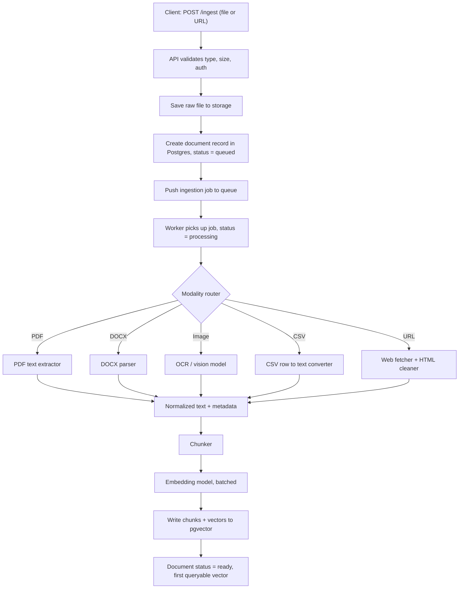

# NeuroFlow System Architecture

## 1. Overview

NeuroFlow is a Retrieval-Augmented Generation (RAG) platform. Users upload documents, ask questions, and receive streamed answers grounded in their own data. Every answer is automatically scored for quality, and the best answers are later used to fine-tune the models.

The system is made of five subsystems:

1. Ingestion: turns raw files into searchable vectors
2. Retrieval: finds the most relevant chunks for a query
3. Generation: builds the prompt, picks an LLM, and streams the answer
4. Evaluation: scores every answer asynchronously
5. Fine-Tuning: learns from the best answers

## 2. Ingestion Subsystem

**Purpose:** Accept raw inputs (PDF, DOCX, images, CSV, web URLs), extract content according to file type, split it into chunks, embed the chunks, and store them in the vector store so they can be searched.

### 2.1 Data Flow: File Upload to First Queryable Vector

### 2.2 Stage Descriptions

| Stage | What happens | Why |
|---|---|---|
| Validate | The API checks the auth token, file type, and file size limit. | Bad input is rejected before it costs any compute. |
| Save raw file | The original file goes to object or disk storage. | The raw file is kept so a document can be re-processed later with a new chunker or embedding model. |
| Document record | A row is created in Postgres with status `queued`. | The client gets a `document_id` back immediately and can poll for status. |
| Job queue | An ingestion job is pushed to a queue (Redis). | Extraction and embedding are slow, so they run in background workers and never block the API. |
| Modality router | The worker picks an extractor based on the file type. | Each format needs different handling. |
| Extractors | PDF and DOCX give text. Images go through OCR or a vision model. CSV rows become text. URLs are fetched and cleaned of HTML noise. | Every modality is turned into the same form: normalized text plus metadata. |
| Chunker | The text is split into chunks (strategy decided in ADR 002). | Chunks must be small enough to embed well and large enough to keep meaning. |
| Embedder | Chunks are sent to the embedding model in batches. | Batching reduces cost and API calls. |
| Vector write | Chunks, vectors, and metadata are written to pgvector (ADR 001). | This is the

### 2.4 Metadata Stored With Each Chunk

Every chunk is stored with metadata so that retrieval can filter and cite sources later.

| Field | Example | Used for |
|---|---|---|
| `chunk_id` | UUID | Unique ID of the chunk |
| `document_id` | UUID | Links the chunk back to its source document |
| `source_type` | `pdf`, `docx`, `image`, `csv`, `url` | Metadata filtering by modality |
| `source_name` | `report.pdf` or the URL | Showing citations to the user |
| `page_or_row` | `12` | Pointing to the exact location in the source |
| `chunk_index` | `5` | Keeping chunks in their original order |
| `created_at` | timestamp | Filtering by date |
| `embedding_model` | model name and version | Knowing which vectors need re-embedding if the model changes |

**Output of this subsystem:** a document with status `ready`, and its chunks stored as vectors in pgvector, searchable by the Retrieval Subsystem.

## 3. Retrieval Subsystem

## 4. Generation Subsystem

## 5. Evaluation Subsystem

## 6. Fine-Tuning Subsystem