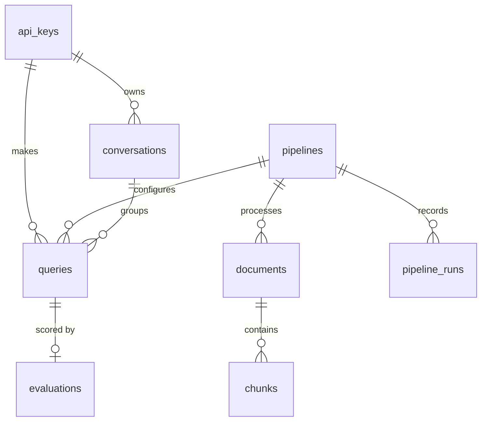

# NeuroFlow Data Models

All data lives in one Postgres database. Vectors are stored with the pgvector extension (see ADR 001), so documents, chunks, evaluations, and logs can be joined in plain SQL.

## 1. Table Overview

| Table | Written by | Purpose |
|---|---|---|
| `pipelines` | `POST /pipelines` | Named pipeline configurations |
| `documents` | Ingestion | One row per ingested file or URL |
| `chunks` | Ingestion | Text chunks with their vectors and metadata |
| `queries` | Generation | One row per query, with the full prompt and response (the generation log) |
| `evaluations` | Evaluation | The four scores and the user rating for each generation |
| `evaluation_aggregates` | Evaluation | Precomputed rolling aggregates |
| `pipeline_runs` | Ingestion and Generation | Execution history of a pipeline |
| `finetune_jobs` | Fine-Tuning | Fine-tuning jobs and their results |

## 2. Ingestion Tables

### 2.1 documents

One row per ingested file or URL. Tracks processing status (see Failure Handling in the Ingestion Subsystem).

```sql
CREATE TABLE documents (
    document_id    UUID PRIMARY KEY,
    pipeline_id    UUID REFERENCES pipelines(pipeline_id),
    source_type    TEXT NOT NULL,        -- pdf, docx, image, csv, url
    source_name    TEXT NOT NULL,        -- file name or URL
    storage_path   TEXT,                 -- where the raw file is kept (null for URLs)
    status         TEXT NOT NULL,        -- queued, processing, ready, failed
    error_code     TEXT,                 -- set when status = failed
    error_message  TEXT,
    chunk_count    INTEGER,              -- null until status = ready
    metadata       JSONB DEFAULT '{}',   -- user-supplied tags from POST /ingest
    created_at     TIMESTAMPTZ NOT NULL DEFAULT now(),
    updated_at     TIMESTAMPTZ NOT NULL DEFAULT now()
);

CREATE INDEX idx_documents_status ON documents(status);
```

### 2.2 chunks

One row per chunk. This is the table that vector search, keyword search, and metadata filtering all run against.

```sql
CREATE TABLE chunks (
    chunk_id         UUID PRIMARY KEY,
    document_id      UUID NOT NULL REFERENCES documents(document_id) ON DELETE CASCADE,
    chunk_index      INTEGER NOT NULL,   -- position within the document
    content          TEXT NOT NULL,
    page_or_row      INTEGER,            -- page number or CSV row, for citations
    source_type      TEXT NOT NULL,      -- copied from the document, for fast filtering
    source_name      TEXT NOT NULL,      -- copied from the document, for citations
    embedding        VECTOR(1536) NOT NULL,
    embedding_model  TEXT NOT NULL,      -- which model made the vector
    content_tsv      TSVECTOR GENERATED ALWAYS AS (to_tsvector('english', content)) STORED,
    metadata         JSONB DEFAULT '{}',
    created_at       TIMESTAMPTZ NOT NULL DEFAULT now(),
    UNIQUE (document_id, chunk_index)
);

CREATE INDEX idx_chunks_embedding ON chunks USING hnsw (embedding vector_cosine_ops);
CREATE INDEX idx_chunks_content_tsv ON chunks USING gin (content_tsv);
CREATE INDEX idx_chunks_document ON chunks(document_id);
CREATE INDEX idx_chunks_source_type ON chunks(source_type);
CREATE INDEX idx_chunks_created_at ON chunks(created_at);
```

**Why each index exists:**

| Index | Used by |
|---|---|
| `hnsw` on `embedding` | Vector similarity search |
| `gin` on `content_tsv` | Keyword (full-text) search |
| `document_id`, `source_type`, `created_at` | Metadata filtering from `POST /query` |

**Notes:**

- `VECTOR(1536)` is an example size. The real dimension is set by the embedding model, and all chunks in one table must use the same dimension. If the embedding model changes, chunks are re-embedded, which is why `embedding_model` is stored on every row.
- `source_type` and `source_name` are copied from `documents` on purpose. It avoids a join during retrieval, which is the hottest query in the system.

## 3. Configuration and Generation Tables

**Creation order note:** `documents` references `pipelines`, so when these tables are created for real, `pipelines` must be created first. They are listed here in the order the system uses them.

### 3.1 pipelines

One row per named pipeline configuration, created by `POST /pipelines`. The three settings groups are stored as JSON, so new settings can be added without changing the table.

```sql
CREATE TABLE pipelines (
    pipeline_id        UUID PRIMARY KEY,
    name               TEXT NOT NULL UNIQUE,
    description        TEXT,
    ingestion_config   JSONB NOT NULL,   -- chunking strategy, chunk size, overlap, embedding model
    retrieval_config   JSONB NOT NULL,   -- candidates, top_k, rrf_k, reranker, min score
    generation_config  JSONB NOT NULL,   -- model preference, system prompt, max tokens, temperature
    created_at         TIMESTAMPTZ NOT NULL DEFAULT now()
);
```

### 3.2 conversations

Groups several queries into one conversation, so earlier turns can be included in the prompt.

```sql
CREATE TABLE conversations (
    conversation_id  UUID PRIMARY KEY,
    api_key_id       UUID NOT NULL,
    created_at       TIMESTAMPTZ NOT NULL DEFAULT now()
);
```

### 3.3 queries

One row per query. This is the generation log described in the Generation Subsystem: the complete input and output of every generation, which evaluation and fine-tuning both depend on.

```sql
CREATE TABLE queries (
    query_id             UUID PRIMARY KEY,
    api_key_id           UUID NOT NULL,        -- the key that made the query
    pipeline_id          UUID REFERENCES pipelines(pipeline_id),
    conversation_id      UUID REFERENCES conversations(conversation_id),
    query_text           TEXT NOT NULL,        -- the user's question
    filters              JSONB DEFAULT '{}',   -- filters sent with the request
    retrieved_chunk_ids  UUID[] NOT NULL DEFAULT '{}',  -- the context, in ranked order
    prompt               TEXT,                 -- the exact prompt sent to the model
    model_used           TEXT,
    response             TEXT,                 -- the full answer, once finished
    status               TEXT NOT NULL,        -- generating, completed, failed
    error_code           TEXT,
    input_tokens         INTEGER,
    output_tokens        INTEGER,
    latency_ms           INTEGER,              -- total time to finish the answer
    time_to_first_token_ms INTEGER,
    created_at           TIMESTAMPTZ NOT NULL DEFAULT now(),
    completed_at         TIMESTAMPTZ
);

CREATE INDEX idx_queries_pipeline ON queries(pipeline_id, created_at DESC);
CREATE INDEX idx_queries_conversation ON queries(conversation_id);
CREATE INDEX idx_queries_api_key ON queries(api_key_id);
```

**Notes:**

- `retrieved_chunk_ids` is what lets the

## 4. Evaluation and Monitoring Tables

### 4.1 evaluations

One row per generation. The row is created with status `pending` when the generation finishes and the evaluation job is queued. The scores are filled in when the judge completes. Creating the row early lets a user rating (`POST /query/{query_id}/rating`) be saved even before scoring is done.

```sql
CREATE TABLE evaluations (
    evaluation_id      UUID PRIMARY KEY,
    query_id           UUID NOT NULL UNIQUE REFERENCES queries(query_id),
    faithfulness       REAL CHECK (faithfulness BETWEEN 0 AND 1),
    answer_relevance   REAL CHECK (answer_relevance BETWEEN 0 AND 1),
    context_precision  REAL CHECK (context_precision BETWEEN 0 AND 1),  -- null if context was empty
    context_recall     REAL CHECK (context_recall BETWEEN 0 AND 1),     -- null if context was empty
    judge_model        TEXT,
    status             TEXT NOT NULL DEFAULT 'pending',  -- pending, completed, failed
    error_message      TEXT,
    user_rating        SMALLINT CHECK (user_rating BETWEEN 1 AND 5),
    rating_comment     TEXT,
    rated_at           TIMESTAMPTZ,
    evaluated_at       TIMESTAMPTZ,
    created_at         TIMESTAMPTZ NOT NULL DEFAULT now()
);

CREATE INDEX idx_evaluations_evaluated_at ON evaluations(evaluated_at DESC);
CREATE INDEX idx_evaluations_finetune_candidates
    ON evaluations(faithfulness, user_rating)
    WHERE status = 'completed';
```

**Notes:**

- The partial index `idx_evaluations_finetune_candidates` speeds up the fine-tuning pair extractor, which selects rows where faithfulness > 0.8 AND user rating >= 4.
- `GET /evaluations` also returns `model_used` and `pipeline_id`. These are not stored here. They come from joining to `queries` through `query_id`, so each fact lives in one place.
- Score columns allow `NULL` because a skipped metric is different from a score of 0.

### 4.2 evaluation_aggregates

Precomputed rolling metrics, refreshed after each batch of evaluations, so `GET /evaluations/aggregate` is fast.

```sql
CREATE TABLE evaluation_aggregates (
    time_window        TEXT NOT NULL,   -- 1h, 24h, 7d
    group_by           TEXT NOT NULL,   -- none, model, pipeline, source_type
    group_key          TEXT NOT NULL,   -- 'all' or the model / pipeline / source type name
    eval_count         INTEGER NOT NULL,
    metrics            JSONB NOT NULL,  -- mean and p5 for each of the four metrics
    mean_user_rating   REAL,            -- null if no ratings in the window
    computed_at        TIMESTAMPTZ NOT NULL,
    PRIMARY KEY (time_window, group_by, group_key)
);
```

**Note:** the table holds one row per window, grouping, and group. A request that adds the `model` or `pipeline_id` filter on top of a grouping can't be answered from these rows, so for those requests the API computes the result directly from `evaluations`.

### 4.3 pipeline_runs

The execution history shown by `GET /pipelines/{id}/runs`. A row is written when an ingestion job or a query starts, and updated when it finishes.

```sql
CREATE TABLE pipeline_runs (
    run_id            UUID PRIMARY KEY,
    pipeline_id       UUID NOT NULL REFERENCES pipelines(pipeline_id),
    run_type          TEXT NOT NULL CHECK (run_type IN ('ingestion', 'query')),
    reference_id      UUID NOT NULL,       -- document_id or query_id, depending on run_type
    status            TEXT NOT NULL,       -- queued, processing, completed, failed
    started_at        TIMESTAMPTZ NOT NULL DEFAULT now(),
    finished_at       TIMESTAMPTZ,
    duration_ms       INTEGER,
    stage_timings_ms  JSONB DEFAULT '{}',  -- e.g. {"retrieval": 640, "generation": 2410}
    error_code        TEXT,
    error_message     TEXT
);

CREATE INDEX idx_pipeline_runs_pipeline
    ON pipeline_runs(pipeline_id, started_at DESC);
```

**Note:** `reference_id` points to different tables depending on `run_type`, so it has no foreign key. This is a deliberate trade-off. It keeps one history table with one index, at the cost of the database not enforcing that the referenced row exists.

## 5. Fine-Tuning and Access Tables

### 5.1 finetune_jobs

One row per fine-tuning job, created by `POST /finetune/jobs` and updated as the job moves through its lifecycle (`queued` → `preparing_data` → `training` → `evaluating` → `completed`, or `failed`).

```sql
CREATE TABLE finetune_jobs (
    job_id                UUID PRIMARY KEY,
    name                  TEXT NOT NULL UNIQUE,
    base_model            TEXT NOT NULL,
    fine_tuned_model      TEXT,              -- null until training finishes
    status                TEXT NOT NULL,     -- queued, preparing_data, training, evaluating, completed, failed
    selection_criteria    JSONB NOT NULL,    -- thresholds, date range, pipeline, max examples
    hyperparameters       JSONB NOT NULL,    -- epochs, learning rate multiplier, batch size
    validation_split      REAL NOT NULL,
    dataset_version       TEXT,              -- null until the dataset is built
    dataset_path          TEXT,              -- where the JSONL file is stored
    training_examples     INTEGER,
    validation_examples   INTEGER,
    training_metrics      JSONB,             -- training and validation loss
    comparison            JSONB,             -- base vs fine-tuned scores on the held-out set
    fine_tuned_is_better  BOOLEAN,           -- null until the evaluating stage finishes
    routing_enabled       BOOLEAN NOT NULL DEFAULT false,
    domain_centroid       VECTOR(1536),      -- average embedding of the training queries
    mlflow_run_id         TEXT,
    error_code            TEXT,
    error_message         TEXT,
    created_at            TIMESTAMPTZ NOT NULL DEFAULT now(),
    updated_at            TIMESTAMPTZ NOT NULL DEFAULT now()
);

CREATE INDEX idx_finetune_jobs_status ON finetune_jobs(status);
CREATE INDEX idx_finetune_jobs_routing ON finetune_jobs(routing_enabled) WHERE routing_enabled;
```

**Notes:**

- `domain_centroid` supports the routing rule in the Fine-Tuning Subsystem. The Model Router compares each new query's embedding to this vector and only uses the fine-tuned model when the query is similar enough.
- `routing_enabled` is only set to `true` when `fine_tuned_is_better` is `true`. Keeping both columns means a job that lost the comparison still has its result on record.
- The training pairs themselves are not stored in this table. The JSONL file at `dataset_path`, identified by `dataset_version`, is the permanent record of what the model was trained on.

### 5.2 api_keys

Stores the keys that authenticate requests (see Authentication in `api-contracts.md`). The key itself is never stored, only a hash of it, so a database leak does not expose working keys.

```sql
CREATE TABLE api_keys (
    api_key_id    UUID PRIMARY KEY,
    name          TEXT NOT NULL,
    key_hash      TEXT NOT NULL UNIQUE,   -- hash of the key, never the key itself
    role          TEXT NOT NULL CHECK (role IN ('api_key', 'admin')),
    is_active     BOOLEAN NOT NULL DEFAULT true,
    created_at    TIMESTAMPTZ NOT NULL DEFAULT now(),
    last_used_at  TIMESTAMPTZ
);
```

`queries.api_key_id` and `conversations.api_key_id` refer to this table. This is how the API enforces that one key cannot read another key's queries.

## 6. How the Tables Relate



| Relationship | Meaning |
|---|---|
| `documents` to `chunks` | One document has many chunks. Deleting a document deletes its chunks. |
| `queries` to `evaluations` | Each query has at most one evaluation. |
| `pipelines` to `documents`, `queries`, `pipeline_runs` | A pipeline is the configuration used by many ingestions and queries, and its history is kept in `pipeline_runs`. |
| `conversations` to `queries` | A conversation groups several queries so earlier turns can be put in the prompt. |
| `api_keys` to `queries`, `conversations` | Ownership. This is how one key is prevented from reading another key's data. |

**Tables with no declared foreign keys:**

| Table | Why |
|---|---|
| `evaluation_aggregates` | It is derived data, rebuilt from `evaluations`. |
| `finetune_jobs` | It points to its training data by file (`dataset_path`) and to its source generations by selection criteria, not by row. |

### 6.1 Table Creation Order

Because of the foreign keys, the tables must be created in this order:

1. `api_keys`
2. `pipelines`
3. `documents`, `conversations`
4. `chunks`, `queries`
5. `evaluations`, `pipeline_runs`
6. `evaluation_aggregates`, `finetune_jobs`

### 6.2 Which Subsystem Uses Which Table

| Subsystem | Reads | Writes |
|---|---|---|
| Ingestion | `pipelines` | `documents`, `chunks`, `pipeline_runs` |
| Retrieval | `chunks`, `pipelines` | none (the retrieved chunk IDs are saved by Generation) |
| Generation | `chunks`, `conversations`, `finetune_jobs` | `queries`, `pipeline_runs` |
| Evaluation | `queries`, `chunks` | `evaluations`, `evaluation_aggregates` |
| Fine-Tuning | `evaluations`, `queries` | `finetune_jobs` |

